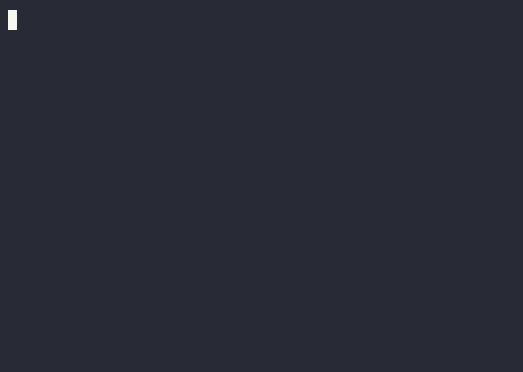

# Mosaic

A Kotlin Multiplatform terminal UI library built on the Compose compiler/runtime.

This is an independently maintained, refactored fork of [JakeWharton/mosaic](https://github.com/JakeWharton/mosaic).
Releases of this fork are distributed through [JitPack](https://jitpack.io/#SparrowAndSnow/mosaic).



Jump to:
[Introduction](#Introduction) |
[Usage](#Usage) |
[Samples](#Samples) |
[Capabilities](#Capabilities) |
[FAQ](#FAQ) |
[License](#License)


## Introduction

The entrypoint to Mosaic is the `runMosaic` function.
The lambda passed to this function is responsible for both output and performing work.

```kotlin
suspend fun main() = runMosaic {
  Text("The count is: 0")
}
```

To change the output dynamically we can use local properties to hold state.
Let's update our counter to actually count to 20.

```kotlin
suspend fun main() = runMosaic {
  var count by remember { mutableIntStateOf(0) }

  Text("The count is: $count")

  LaunchedEffect(Unit) {
    for (i in 1..20) {
      delay(250.milliseconds)
      count = i
    }
  }
}
```

(Note: You may need to add imports for `androidx.compose.runtime.getValue` and `import androidx.compose.runtime.setValue` manually.)


That is the most basic sample of Mosaic.
From there, the limit is only your imagination.


_(Note: graphs in the above have rendering problems due to asciinema/agg which do not appear in the real output)_

## Usage

Mosaic is a library for Compose, and it relies on JetBrains' Kotlin Compose plugin to be present for use.
Any module which wants to call `runMosaic` or define `@Composable` functions for use with Mosaic must have this plugin applied.
For more information, see [the JetBrains Compose compiler documentation](https://www.jetbrains.com/help/kotlin-multiplatform-dev/compose-compiler.html).

Add JitPack alongside Maven Central and Google in your dependency repositories:

```kotlin
// settings.gradle.kts
dependencyResolutionManagement {
  repositories {
    google()
    mavenCentral()
    maven("https://jitpack.io") {
      content { includeGroup("com.github.SparrowAndSnow.mosaic") }
    }
  }
}
```

The `0.19.0` GitHub release is available, but its JitPack publication failed. The distribution
fix has passed JVM and Native consumer checks and is awaiting a corrected release.

After the corrected release is published, add the module you need using its release tag from
[GitHub Releases](https://github.com/SparrowAndSnow/mosaic/releases):

```kotlin
dependencies {
  implementation("com.github.SparrowAndSnow.mosaic:mosaic-runtime:0.19.0")
  // Optional:
  implementation("com.github.SparrowAndSnow.mosaic:mosaic-animation:0.19.0")
  testImplementation("com.github.SparrowAndSnow.mosaic:mosaic-testing:0.19.0")
}
```

Version `0.19.0` is the first release of this fork. Use the exact release tag
as the version for all modules.
The Kotlin Multiplatform coordinates select JVM, Linux x64/arm64, macOS arm64, or Windows x64
artifacts automatically. JVM jars include JNI libraries for Linux, macOS, and Windows;
plain Java/Maven consumers can explicitly select `mosaic-runtime-jvm`.

Releases are built from source on a macOS GitHub Actions runner to include Apple C interop,
then JitPack installs the complete Maven repository attached to that release. Wait for the
release workflow to finish before looking up the tag on JitPack. Branch snapshots and commit-only
versions are not supported by this release pipeline. See [RELEASING.md](RELEASING.md).

The `com.jakewharton.mosaic` Kotlin packages are retained for source compatibility. Avoid mixing
this fork with upstream Mosaic artifacts in one application.

API documentation can be generated locally with `./gradlew dokkaGenerate` (output:
`build/dokka/html/`); runnable examples are listed below.

## Samples

Run `./gradlew installDist` to build the sample binaries.

 * [Counter](samples/counter): A simple increasing number from 0 until 20.

   `./samples/counter/build/install/counter/bin/counter`

 * [Demo](samples/demo): A playground for demonstrating many features of Mosaic.

   `./samples/demo/build/install/demo/bin/demo`

 * [Showcase](samples/showcase): Focused demonstrations of Unicode, text, layout, input, fields,
   animation, scrolling, lazy lists, borders, and overlays.

   `./samples/showcase/build/install/showcase/bin/showcase`

 * [Test console](samples/test-console): A test-runner style console with fake tests.

   `./samples/test-console/build/install/test-console/bin/test-console`

 * [Robot](samples/robot): An interactive, game-like program with keyboard control.

   `./samples/robot/build/install/robot/bin/robot`

 * [monitor](samples/monitor): A top-like process monitor with fake data.

   `./samples/monitor/build/install/monitor/bin/monitor`

 * [snake](samples/snake): Snake game.

   `./samples/snake/build/install/snake/bin/snake`

## Capabilities

### Text & Unicode
* Text is measured and painted at grapheme-cluster granularity, so combining sequences, ZWJ
  families, flags, emoji with variant selectors, and wide CJK characters occupy their true cell
  width instead of being split or truncated mid-cluster.
* When the terminal reports DEC 2027 grapheme clustering, the terminal performs the cluster
  handling itself; otherwise Mosaic falls back to its own cluster-width model.

### Rendering
* Frames are diffed cell-by-cell and only the changed regions are emitted, keeping steady-state
  output small; synchronized-output wrapping is emitted when supported to avoid flicker.
* `Mosaic.draw()` exposes a `TextCanvas`; `render(ansiLevel, supportsKittyUnderlines)` produces a
  stable, non-diffing picture suitable for redirected output.

### Layout
* Compose-style modifier chains: preferred/required size, size ranges, fill fractions, weighting,
  aspect ratio, clip-to-bounds, and intrinsic sizing.
* `Row`/`Column`/`Box` with alignment, spacing, and weight distribution; `BoxWithConstraints` for
  proportional layouts; layout caching to skip unchanged subtrees.
* Text overloads: soft wrapping, truncation (clip/ellipsis), horizontal/vertical alignment, and a
  scrolling view window.
* Opt-in momentum scrolling (`MomentumScrollState`): the application advances the state from its own
  frame loop and maps `position` into layout.

### Interactivity
* Keyboard input including named keys, repeats, and the kitty keyboard protocol when supported.
* Pointer input: hover and click via `hoverable`/`clickable`, plus press, release, motion, and drag
  events via `onMouseEvent`.
* Bracketed paste and clipboard read/write (OSC 52).
* Focus tracking with Tab/Shift+Tab traversal, plus focus, resize, and theme change events.
* Hardware cursor placement (`Cursor`) with block, underline, or bar shapes and optional blinking,
  restored to the terminal default on exit.

### Animation
* Value animation (tween/spring), `animateXAsState`-style helpers, plus `Crossfade` and
  enter/exit containers, all driven by the common frame clock.

### Known limitations
* The terminal is assumed to be UTF-8; running under a non-UTF-8 locale is not supported.
* Live redraw requires a real TTY; running inside a build tool or IDE is not supported (see the
  FAQ below).
* Windows and macOS code paths are developed against Linux; their behavior is exercised by tests
  run in CI.
* Windows console mouse records are consumed to keep input responsive, but are not currently
  delivered to applications.
* `TERM=dumb` does not disable color on Windows; use `NO_COLOR` when ANSI output must be disabled.
* A forced process termination or console close can bypass teardown and leave terminal modes
  altered.
* The composition root is measured with unbounded constraints. Fill-relative modifiers such as
  `fillMaxWidth` only distribute space when an ancestor supplies a bounded width or height, so an
  app that wants to fill the whole screen should wrap its content in an explicit-size container.

## FAQ

### I thought Compose was a UI toolkit for Android?

Compose is, at its core, a general-purpose compiler and runtime to do state tracking and tree node
and property manipulation. This can be used on any platform supported by Kotlin for any kind of
state or with any tree. It's an amazing piece of technology.

Compose UI is the modern UI toolkit for Android which also runs on the desktop, iOS, and the web.
The lack of differentiation between these two technologies has unfortunately caused Compose UI to
overshadow the core under the single "Compose" moniker in an unforced marketing error.

Other examples of non-Compose UI-based Compose projects are Cash App's Redwood,
JetBrains' Compose HTML, or Google's Jetpack Glance.

### Broken output with `./gradlew run` and/or inside IntelliJ IDEA

Running within Gradle or IntelliJ IDEA will not work. These tools do not provide access to the TTY
in order to be interactive. And for non-interactive programs, both will strip ANSI control
characters which prevent Mosaic from redrawing over a previous frame. The output will likely just
render in successive lines instead.

Run your programs directly in a terminal emulator–no IDE and no Gradle.


# License

    Copyright 2020 Jake Wharton

    Licensed under the Apache License, Version 2.0 (the "License");
    you may not use this file except in compliance with the License.
    You may obtain a copy of the License at

       http://www.apache.org/licenses/LICENSE-2.0

    Unless required by applicable law or agreed to in writing, software
    distributed under the License is distributed on an "AS IS" BASIS,
    WITHOUT WARRANTIES OR CONDITIONS OF ANY KIND, either express or implied.
    See the License for the specific language governing permissions and
    limitations under the License.
